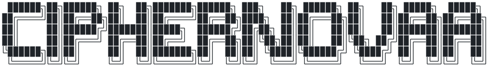
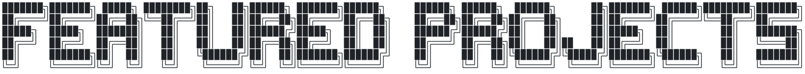
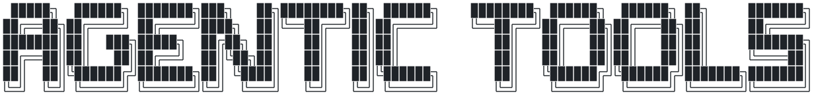
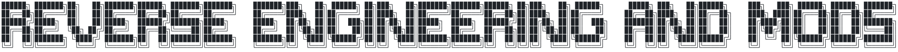
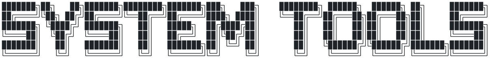
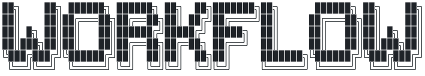
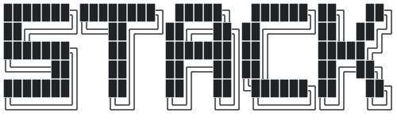

<b>Independent software development · Agentic reverse engineering</b> 
C++ / Qt 6 · QML · Python · C · FFmpeg · Linux · Markdown · Lua 
codec v1.49 · twine-pc

<i>Building ambitious software with modern tools.</i>

 

<table>
<tr>
<td width="50%" valign="top">

### [codec](https://github.com/CipherNovaa/codec)
Own your entertainment and keep your media accessible. Experience immersive visual presentation, invite online friends to your theatre and watch together without compromise; a simple link, absolutely minimal hardware and setup with CODEC media player, built with Qt 6 / QML on libmpv, a Python hub, custom-styled Google Cast receiver for local casting to televisions on LAN. Secure YouTube integration, **Native, Seamless Dolby Vision and HDR Support**, film/TV review (Obsidian) and automated library management. Free-flowing mixed-format queue, behind-the-scenes/audio commentary, subtitles with automatic local OCR styling and absolute timing verification.

`C++20` `QML` `Python` `FFmpeg` `Cast` · 976 commits over four months

</td>
<td width="50%" valign="top">

### [twine-pc](https://github.com/CipherNovaa/twine-pc)
A native PC fan remake of *007: The World Is Not Enough* (2000, original PlayStation). All **14 assembly executables decompiled to byte-identical C**, then given new engine logic: Vulkan and software renderers, smooth camera motion, refresh rate, modern controls, additional gameplay improvements and an all-new Endless mode.

`C` `Vulkan` `Windows` `Linux` `Ghidra` · decompilation · reverse engineering

</td>
</tr>
</table>

 

<table>
<tr>
<td width="24%" valign="top"><b><a href="https://github.com/CipherNovaa/agent-skills">agent-skills</a></b></td>
<td valign="top">Double-agent skill system: cloud LLM as architect, local LLM model as operator, minimising token spending. A skill contract with earned autonomy and mandatory absolute verification, escalation from the local model to Cloud, a drift-detecting janitor, and shared memory across machines.</td>
</tr>
<tr>
<td width="24%" valign="top"><b><a href="https://github.com/CipherNovaa/supernote-agent">supernote-agent</a></b></td>
<td valign="top">Handwritten notes on an e-ink tablet become clean Obsidian notes through local LLMs, seamlessly import print media for rapid learning and library management. Handwritten <code>//commands</code> trigger actions, and plain-English feedback turns into JSON actions that teach it your style.</td>
</tr>
</table>

 

<table>
<tr>
<td width="24%" valign="top"><b><a href="https://github.com/CipherNovaa/codecos-remote">codecos-remote</a></b></td>
<td valign="top">An e-ink universal remote's BLE protocol and two-chip firmware, reversed and rebuilt as custom firmware with an e-paper display screensaver, then wrapped in a desktop control app. Utilizing multiple code agents such as cloud LLMs, Hermes and Codex for translating foreign documentation, writing and patching firmware with reusable tooling and extended logging.</td>
</tr>
<tr>
<td width="24%" valign="top"><b><a href="https://github.com/CipherNovaa/ac6-crt-5to4">ac6-crt-5to4</a></b></td>
<td valign="top">Armored Core VI modification to run offline on a 5:4 CRT display: a D3D12 hook for the 3D, a controlled EAC gate for true ranked vanilla/online play with online integrity verification. Scaleform tools to re-lay the HUD and menus, with agentic capture and editing tools.</td>
</tr>
<tr>
<td width="24%" valign="top"><b><a href="https://github.com/CipherNovaa/mgs4-crt">mgs4-crt</a></b></td>
<td valign="top">Metal Gear Solid 4: Master Collection 5:4 resolution and FOV modification for CRT displays: replaces letterboxed image and re-fits every 2D sprite to its true shape from its vertices and shader constants.</td>
</tr>
</table>

 

<table>
<tr>
<td width="24%" valign="top"><b><a href="https://github.com/CipherNovaa/hyprule">hyprule</a></b></td>
<td valign="top">A GTK4 window-rule manager for Hyprland's Lua configuration file.</td>
</tr>
<tr>
<td width="24%" valign="top"><b><a href="https://github.com/CipherNovaa/pipewire-surround">pipewire-surround</a></b></td>
<td valign="top">Seamless binaural 7.1 for headphones on PipeWire, generated from HRTF data, switching audio channels (surround to stereo) automatically based on headset power state.</td>
</tr>
<tr>
<td width="24%" valign="top"><b><a href="https://github.com/CipherNovaa/keybr-ws">keybr-ws</a></b></td>
<td valign="top">A typing lesson dashboard overlay, integrated into the system on a keypress. keybr.com: browser extension → native host → ImGui.</td>
</tr>
<tr>
<td width="24%" valign="top"><b><a href="https://github.com/CipherNovaa/dotfiles">dotfiles</a></b></td>
<td valign="top">A Hyprland desktop where one wallpaper rethemes about fifteen apps, with Quickshell widgets and a CRT gaming corner.</td>
</tr>
</table>

 

codec is my clearest example and my largest current project: over 110,000 lines of C++, QML and Python, built in four months with multiple agentic coding development tools. What that looks like in practice:

- **A unified, multi-device-compatible persistent memory the agents work from.** A project map (inside the project's agent instructions file) and 89 topic notes record every subsystem, decision and trap, so each session starts where the last one stopped instead of re-learning the codebase or wasting development time and tokens - keeping working context accurate and efficient while reducing hallucination rate.
- **The right agent for the job.** Parallel read-only subagents explore and map a 20,000-line server before it's changed; a dedicated forensics agent works through cast telemetry on the hardest Dolby Vision and Cast receiver bugs; the main session drives the building with informative feedback and transparency for me to verify edits and view changed code.
- **Audits as workflows.** A repeatable controlled multi-subagent swarm audit (a finder model per slice of the codebase, a skeptical checker model re-verifying each finding) ran twice over codec: 146 and 104 findings, catalogued to an artifact with descriptions and severity so nothing is glossed over; efficient, steady progress fixed and verified with confidence.
- **Custom Markdown LLM skills and permission gates** that encode how a subsystem is reviewed, or how an overnight media pipeline is checked, so the method is reusable rather than remembered. [agent-skills](https://github.com/CipherNovaa/agent-skills) is the same idea grown into a framework: a skill contract with earned autonomy, run by a local model and escalated to Cloud models.
- **Giving agents eyes.** Tools that capture what's really on screen (a game's backbuffer, a TV's output, raw memory cache traces and additional logging) further minimizing dangerous hallucination risks.
- **Absolute verification gates.** An offscreen screenshot harness for every view, a headless preview of the TV receiver, frame meters, and captures from the actual television. An agent's "it works" is considered a hallucination until each absolute verification gate is passed.
- **Consistently documenting difficult challenges, and putting learning first.** [codec's engineering notes](https://github.com/CipherNovaa/codec/blob/main/docs/ENGINEERING.md) tell nine of the hardest bugs: what was seen, what it really was, and how it was proven. Very often LLMs will attempt to gaslight the user into believing something is "impossible"; the only way to truly know what is possible or correct is through detailed understanding.

 

`C++` `C` `Python` `QML / Qt 6` `JavaScript` `Bash` · `FFmpeg` `libmpv` `NVENC` `Vulkan` `libplacebo` · `Google Cast` `DASH / HLS` `Dolby Vision` · `PipeWire` `D-Bus` `systemd` `Hyprland` · (subagents, skills, workflows, MCP)
